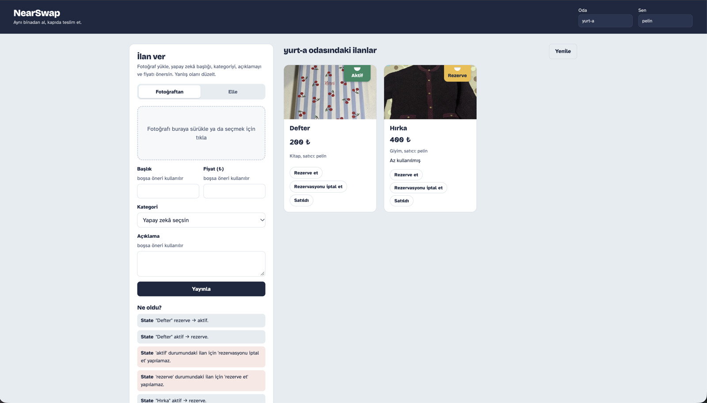

# NearSwap

Yurt ve siteler için yapay zekâ destekli ikinci el pazar yeri.
EBLG443 Tasarım Kalıpları dönem projesi, İstanbul Nişantaşı Üniversitesi.

| | |
|---|---|
| Ekip | Pelin ALACA (20222022383), Handan VURAL (20222022396) |
| Dil | Python 3.11+, FastAPI |
| Tasarım kalıpları | Builder, Adapter, State, Chain of Responsibility |
| Yapay zekâ | Fotoğraftan ilan taslağı üretme, ilanı yayından önce denetleme (Gemini ya da OpenAI) |

| Belge | İçerik |
|---|---|
| [docs/TASARIM.md](docs/TASARIM.md) | Dört kalıbın problemi, rolleri, sınıf diyagramları ve tasarım kararları |
| [docs/KURULUM.md](docs/KURULUM.md) | Gereksinimler, kurulum adımları, yapılandırma, sık karşılaşılan durumlar |
| [docs/TEST.md](docs/TEST.md) | Otomatik testler, kapsam, kalıplara göre testler, elle test senaryosu |



*Kullanıcı arayüzü. Kartların köşesindeki etiket ilanın durumunu gösterir; "Ne oldu?" günlüğü her işlemde hangi kalıbın çalıştığını yazar. Burada State kalıbı, aktif bir ilanda rezervasyon iptalini ve rezerve bir ilanı tekrar rezerve etmeyi reddediyor.*


## Çalıştırma

Ayrıntılı adımlar ve sorun giderme için [docs/KURULUM.md](docs/KURULUM.md).

```bash
python3 -m venv .venv
source .venv/bin/activate                 # Windows: .venv\Scripts\activate
pip install -e ".[dev,ai]"
cp .env.example .env                      # Windows: copy .env.example .env
uvicorn nearswap.api:app
```

- **http://127.0.0.1:8000/**: kullanıcı arayüzü. İlan verme, oda panosu, durum değiştirme ve her işlemde hangi kalıbın çalıştığını gösteren "Ne oldu?" günlüğü.
- **http://127.0.0.1:8000/docs**: bütün uç noktaların etkileşimli belgesi.

Varsayılan yapay zekâ sağlayıcısı `fake`'tir: API anahtarı gerektirmez ve her fotoğrafa sabit bir taslak döner. Gerçek yapay zekâ için `.env` içinde `NEARSWAP_AI_PROVIDER=gemini` (ya da `openai`) yapılır ve ilgili anahtar girilir.

```bash
pytest                                    # 125 test, kodun %99'u; ayrıntı: docs/TEST.md
mypy                                      # strict tip denetimi
python scripts/try_ai.py urun.jpg         # seçili sağlayıcıyı sunucu olmadan deneme
```

## Dosya yapısı

```
nearswap/
├── models.py         Listing, Category, ListingDraft, ModerationResult, hatalar, turkish_lower
├── builder.py        Builder                   (yaratımsal)
├── ai.py             Adapter                   (yapısal)
├── states.py         State                     (davranışsal)
├── moderation.py     Chain of Responsibility   (davranışsal)
├── service.py        ListingService: kalıpları ilan verme akışında birleştirir
├── storage.py        JsonFileStore: ilanları ve fotoğrafları diskte saklar
├── api.py            FastAPI uç noktaları
└── static/index.html kullanıcı arayüzü
tests/                her modül için ayrı test dosyası
scripts/try_ai.py     yapay zekâ sağlayıcısını elle deneme
docs/TASARIM.md       tasarım belgesi
```

## Kalıplar ve roller

| Kalıp | Rol | Sınıf |
|---|---|---|
| **Builder** | Product | `Listing` |
| | Builder | `ListingBuilder` |
| | ConcreteBuilder | `StandardListingBuilder` |
| | Director | `ListingDirector` (`from_form`, `from_ai_draft`) |
| **Adapter** | Target | `AIService` |
| | Adaptee | `openai.OpenAI`, `google.genai.Client` |
| | Adapter | `OpenAIAdapter`, `GeminiAdapter` (testler için `FakeAIAdapter`) |
| **State** | Context | `Listing` |
| | State | `ListingState` |
| | ConcreteState | `DraftState`, `ActiveState`, `ReservedState`, `SoldState` |
| **Chain of Responsibility** | Handler | `ModerationHandler` |
| | ConcreteHandler | `BannedWordsHandler` → `PriceSanityHandler` → `AIModerationHandler` |
| | Client | `ListingService` |

Bütün arayüzler `abc.ABC` ile tanımlıdır ve her rol ayrı bir sınıfla karşılanır. Kalıplar çatıdan bağımsızdır; FastAPI yalnızca dış katmandır.

## Fotoğraftan ilan verme akışı

```
POST /ai/draft                              fotoğraf seçilince
  └─ AIService.draft_listing(photo)         Adapter   -> ListingDraft (sunucuda saklanır, draft_id döner)

POST /listings/from-draft                   Yayınla'ya basınca (kullanıcının düzeltmeleriyle)
  ├─ ListingDirector.from_ai_draft(...)     Builder   -> Listing (taslak)
  ├─ zincir.handle(listing)                 Chain     -> BannedWords → PriceSanity → AIModeration
  └─ listing.publish()                      State     -> aktif
```

Taslak yayınlarken yeniden üretilmez; yapay zekâ bir kez taslak, bir kez denetim için çağrılır.

## Uç noktalar

| Yöntem | Yol | Ne yapar |
|---|---|---|
| GET | `/` | Kullanıcı arayüzü |
| POST | `/ai/draft` | Fotoğraftan taslak önerir ve saklar (`draft_id` döner), ilan oluşturmaz |
| POST | `/listings/from-draft` | Saklanan taslaktan ilan verir; yapay zekâ yalnızca denetim için çağrılır |
| POST | `/listings/from-photo` | Fotoğraftan tek adımda ilan verir (başlık, fiyat, kategori, açıklama isteğe bağlı) |
| POST | `/listings` | Formdan ilan verir |
| GET | `/rooms/{room_id}/listings` | Odadaki ilanlar |
| GET | `/listings/{id}` | Tek ilan |
| POST | `/listings/{id}/reserve` | Rezerve et |
| POST | `/listings/{id}/cancel-reservation` | Rezervasyonu iptal et |
| POST | `/listings/{id}/sold` | Satıldı olarak işaretle |
| POST | `/photos` | Fotoğraf yükler, adresini döner |
| GET | `/photos/{id}` | Yüklenen fotoğraf |

Hata kodları: geçersiz ilan ve denetim reddi **422**, ilanın durumunda izin verilmeyen işlem **409**, bulunamayan ilan **404**, yapay zekâ servisine ulaşılamaması **503**.

## Yapılandırma (`.env`)

| Değişken | Varsayılan | Açıklama |
|---|---|---|
| `NEARSWAP_AI_PROVIDER` | `fake` | `fake`, `gemini` ya da `openai` |
| `GEMINI_API_KEY`, `OPENAI_API_KEY` | | Seçilen sağlayıcının anahtarı |
| `NEARSWAP_GEMINI_MODEL` | `gemini-3.8-flash` | Gemini model adı |
| `NEARSWAP_GEMINI_THINKING` | `low` | Gemini'nin düşünme düzeyi: `low`, `medium` ya da `high`; boş bırakılırsa modelin varsayılanı |
| `NEARSWAP_OPENAI_MODEL` | `gpt-4o-mini` | OpenAI model adı |
| `NEARSWAP_DATA_DIR` | `data` | İlanların ve fotoğrafların saklandığı klasör |

`.env` ve `data/` git'e eklenmez.

## Kapsam

Kullanıcı kaydı, oda üyeliği ve mesajlaşma bu sürümün kapsamı dışındadır; oda, ilandaki `room_id` alanıyla temsil edilir. Veriler JSON dosyalarında saklanır.
