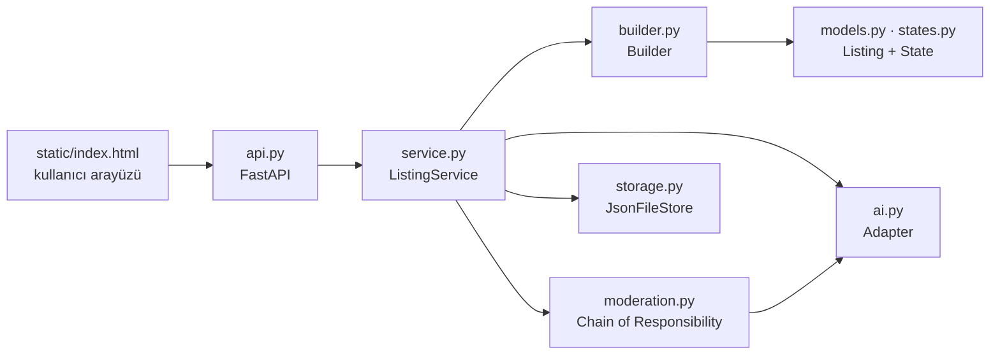
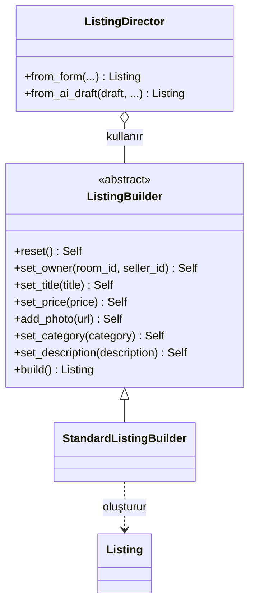
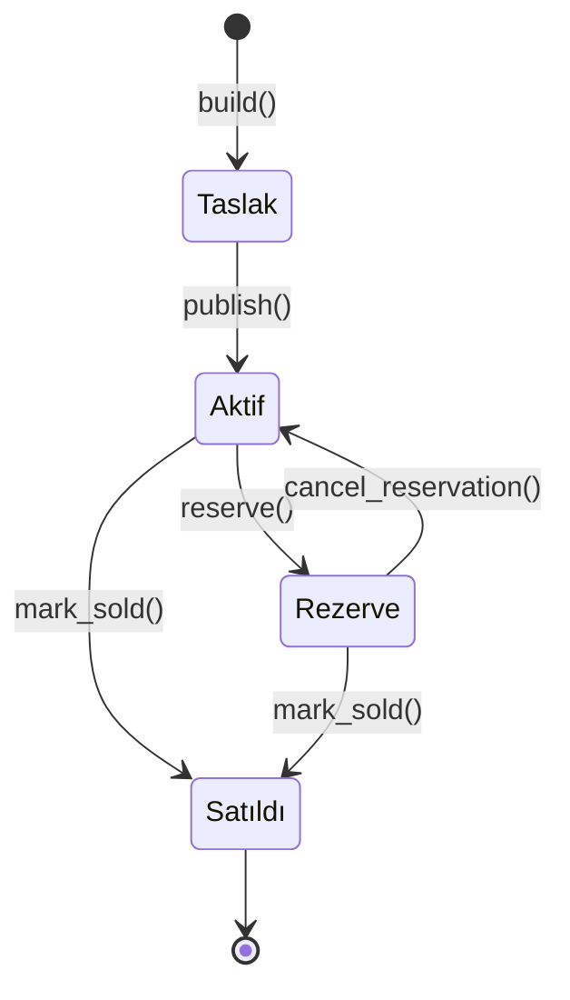
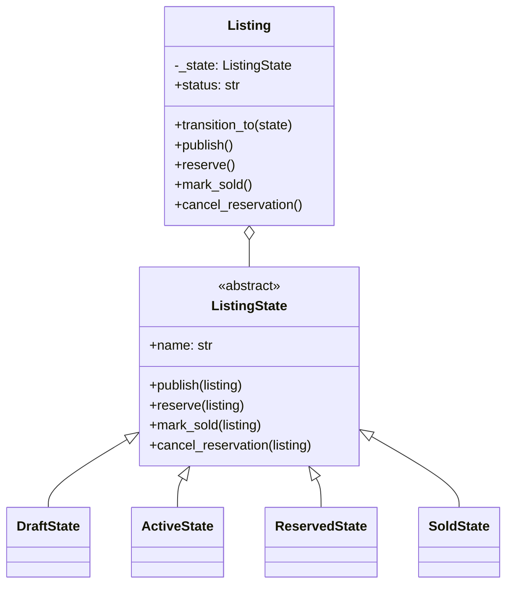
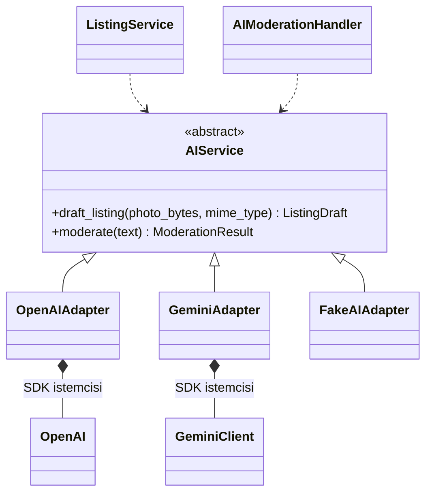
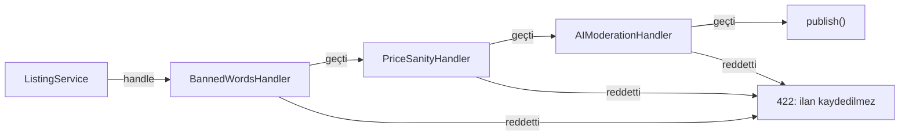
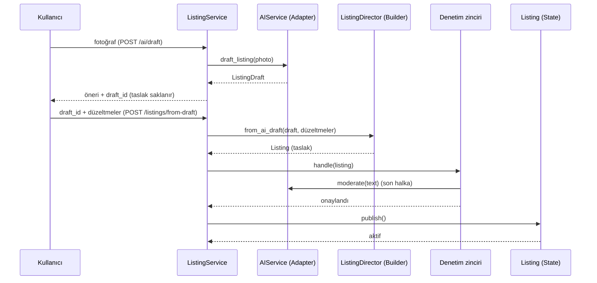

# NearSwap Tasarım Belgesi

EBLG443 Tasarım Kalıpları · Pelin ALACA (20222022383), Handan VURAL (20222022396)

## 1. Problem ve kapsam
Satıcı ürünün fotoğrafını yükler, yapay zekâ başlık, kategori, açıklama ve fiyat önerir, satıcı bunları düzeltir. İlan yayına çıkmadan önce otomatik olarak denetlenir. İlan aktif, rezerve ve satıldı durumlarından geçer.

**Bu sürümün kapsamı:** fotoğraftan ya da formdan ilan verme, yayın öncesi denetim, ilan durumunu yönetme, bir odanın ilanlarını listeleme. Kullanıcı kaydı, oda üyeliği ve mesajlaşma kapsam dışıdır. Öneri dokümanında yer alan bildirim özelliği ve onu karşılayacak Observer kalıbı, kapsamı daraltmak için bu sürüme alınmamıştır.

## 2. Mimari

- **models.py:** ortak veri tipleri (`Listing`, `Category`, `ListingDraft`, `ModerationResult`) ve hatalar.
- **builder.py, ai.py, states.py, moderation.py:** dört tasarım kalıbı. Hiçbiri web çatısını bilmez.
- **service.py:** kalıpları ilan verme akışında birleştiren uygulama katmanı.
- **storage.py:** ilanları ve fotoğrafları JSON dosyalarında saklayan yardımcı katman.
- **api.py:** HTTP katmanı. Yalnızca `ListingService`'i çağırır; servis `create_app()` içinde açıkça verilir.

Bütün arayüzler `abc.ABC` ile tanımlıdır, her kalıp rolü ayrı ve anlamlı adlandırılmış bir sınıfla karşılanır. Tip denetimi mypy strict modunda yapılır.

## 3. Builder (yaratımsal) · `builder.py`

### Problem

Bir ilan dokuz bilgiden oluşur ve bu bilgiler tek seferde gelmez. Fotoğraftan ilan verilirken önce fotoğraf gelir, ardından yapay zekâ başlık, kategori, açıklama ve fiyat önerir, en son kullanıcı bunların bir kısmını düzeltir. Formdan ilan verilirken ise bütün bilgiler aynı anda gelir. Her iki durumda da aynı kural geçerlidir: **eksik ya da hatalı bir ilan nesnesi hiç oluşmamalıdır.**

### Çözüm

İlanın parçaları bir kurucu nesnede adım adım biriktirilir. `build()` bütün kuralları tek yerde denetler ve ilanı ancak her şey doğruysa, **taslak** durumunda üretir. `ListingDirector` aynı adımlardan iki farklı kurma sırası sunar.

| GoF rolü | Sınıf | Görevi |
|---|---|---|
| Product | `Listing` | Kurulan nesne |
| Builder | `ListingBuilder(ABC)` | Kurma adımlarının arayüzü |
| ConcreteBuilder | `StandardListingBuilder` | Parçaları biriktirir, `build()` içinde doğrular |
| Director | `ListingDirector` | `from_form()` ve `from_ai_draft()` kurma sıraları |

### Tasarım kararları

- **Bütün sorunlar birlikte bildirilir.** `build()` ilk hatada durmaz; oda ve satıcı, başlık (boş olmamalı, en fazla 80 karakter), fiyat (sıfırdan büyük), en az bir fotoğraf ve kategori kurallarının hepsini denetler, eksikleri tek bir `ListingValidationError` içinde döner. Kullanıcı formu bir kez gönderip neyi düzeltmesi gerektiğini birlikte görür.
- **Yapısal kurallar Builder'da, içerik kuralları zincirde.** Yasaklı kelime, makul fiyat ve yapay zekâ denetimi Chain of Responsibility'nin işidir. Bu yüzden zincirde ayrıca bir "zorunlu alan" halkası yoktur ve iki kalıp aynı işi yapmaz.
- **İki kaynaktan kurma.** `from_ai_draft()` yapay zekâ taslağıyla başlar; kullanıcının verdiği başlık, fiyat, kategori ya da açıklama taslaktakinin yerine geçer. Fiyat için `is not None` kontrolü kullanılır: kullanıcı fiyatı 0 girerse bu değer korunur ve `build()` tarafından reddedilir, sessizce yapay zekânın fiyatıyla değiştirilmez.
- **Director soyutlamaya bağlıdır.** Director, `StandardListingBuilder`'ı değil `ListingBuilder` arayüzünü alır; farklı kurallara sahip bir kurucu (örneğin fiyatı sıfır olan bağış ilanı) Director değişmeden eklenebilir.
- **Kurucu yeniden kullanılabilir.** `build()` ilanı ürettikten sonra kurucuyu sıfırlar; fotoğraf listesi değiştirilemez bir `tuple` olarak kopyalanır.

### Değerlendirilen alternatif

`dataclass` ve `__post_init__` ile doğrulama, nesnenin tek seferde ve bütün alanlarıyla oluşturulmasını gerektirir; adım adım dolan bir ilanın ara hâlini tutacak bir yer sunmaz ve genellikle ilk hatada durur. Builder, ara hâli kurucuda tutar ve iki farklı kurma sırasını Director'da toplar.

### Testler · `tests/test_builder.py` (10 test)

Eksik alanların birlikte bildirilmesi, başlık uzunluğu sınırı, kurucunun sıfırlanması, iki Director senaryosu, kullanıcının taslaktaki alanları düzeltmesi ve yapay zekâ fiyat öneremediğinde kullanıcıdan fiyat istenmesi.

## 4. State (davranışsal) · `states.py`

### Problem

Bir ilanın hangi işlemlere izin verdiği durumuna göre değişir. Kalıp olmadan her işlem metodu, dört durumun hepsi için ayrı `if` dalları içerirdi (4 işlem × 4 durum = 16 dal); yeni bir durum eklemek bütün metotları değiştirmeyi gerektirirdi.

### Çözüm

Durum bir metin değil, bir nesnedir. Her durum kendi sınıfıdır ve hangi işleme izin verdiğini kendisi bilir. `Listing` hiçbir karar vermez, her işlemi o anki durum nesnesine devreder.

| Durum | `publish()` | `reserve()` | `mark_sold()` | `cancel_reservation()` |
|---|---|---|---|---|
| Taslak | Aktif'e geçer | Hata | Hata | Hata |
| Aktif | Hata | Rezerve'ye geçer | Satıldı'ya geçer | Hata |
| Rezerve | Hata | Hata | Satıldı'ya geçer | Aktif'e döner |
| Satıldı | Hata | Hata | Hata | Hata |

| GoF rolü | Sınıf | Görevi |
|---|---|---|
| Context | `Listing` | Durumu tutar, işlemleri duruma devreder |
| State | `ListingState(ABC)` | Ortak arayüz ve varsayılan davranış |
| ConcreteState | `DraftState`, `ActiveState`, `ReservedState`, `SoldState` | Her biri kendi geçiş kuralını taşır |

### Tasarım kararları

- **Varsayılan davranış ata sınıfta.** GoF'taki gibi `ListingState` her işlem için varsayılan davranışı tanımlar: `InvalidTransitionError`. Her somut durum yalnızca izin verdiği işlemleri yeniden yazar; `SoldState` hiçbir işlem metodu içermez. Hata kodu bir kez yazılır.
- **Geçişi durum yapar.** Somut durum, işlemi kabul ettiğinde `listing.transition_to(YeniDurum())` çağırır. Kodda `if listing.status == ...` kontrolü yoktur.
- **Açık/Kapalı ilkesi.** Yeni bir durum eklemek için yeni bir sınıf yazılır; `Listing` sınıfının karar mantığında hiçbir değişiklik gerekmez.
- **Başarısız işlem durumu değiştirmez.** Testler, hata fırlatan her işlemden sonra ilanın eski durumunda kaldığını doğrular.
- **Hata mesajı Türkçe.** Mesaj API'nin 409 yanıtında kullanıcıya gösterildiği için işlem adları Türkçedir ("rezerve et").
- **Kalıcılıkla uyum.** `storage.py` yalnızca durumun adını kaydeder ve yüklerken adı ilgili durum sınıfına çevirir. Geçiş kuralları yalnızca `states.py` içindedir; diskten yüklenen satılmış bir ilan da rezerve edilemez.
- **Builder ile bağlantı.** Builder her ilanı `DraftState` ile üretir; ilan denetimden geçtikten sonra `publish()` ile aktif olur.

### Değerlendirilen alternatif

Durumu bir `Enum` ve izinli geçişleri bir sözlükte tutmak daha az sınıfla çalışır, ancak duruma özgü davranış (ileride örneğin "rezerve ilanda alıcıya hatırlatma") eklendiğinde mantık yine tek bir yerde `if` dallarına döner. State kalıbında her durumun davranışı kendi sınıfında kalır.

### Testler · `tests/test_states.py` (18 test), `tests/test_models.py`

Geçiş tablosunun 16 hücresinin her biri ayrı bir test olarak çalışır; ilan, gerçek geçişlerle istenen duruma getirilir. Ek olarak hata mesajı, arayüzün soyutluğu, `Listing`'in her işlemi duruma devretmesi ve ata sınıfın varsayılan davranışı sınanır.

## 5. Adapter (yapısal) · `ai.py`

### Problem

Yapay zekâ iki iş için kullanılır: fotoğraftan ilan taslağı üretmek ve ilan metnini yayından önce denetlemek. İki sağlayıcı desteklenir ve ikisi farklı biçimde çağrılır: OpenAI'da taslak için Chat Completions, denetim için ayrı bir Moderations API; Gemini'de ikisi için de `generate_content`. Uygulama bu farkları bilseydi iş mantığı sağlayıcı koşullarıyla dolar ve testler gerçek API'ye bağımlı olurdu.

### Çözüm

Uygulamanın beklediği arayüz (`AIService`) bir kez tanımlanır. Her sağlayıcı için bir Adapter, SDK istemcisini içinde tutar (nesne adaptörü, bileşim), çağrıyı SDK'nın diline çevirir ve yanıtı ortak tiplere (`ListingDraft`, `ModerationResult`) dönüştürür.

| GoF rolü | Sınıf | Görevi |
|---|---|---|
| Target | `AIService(ABC)` | `draft_listing(photo_bytes, mime_type)`, `moderate(text)` |
| Adaptee | `openai.OpenAI`, `google.genai.Client` | Dış kütüphanelerin kendi arayüzleri |
| Adapter | `OpenAIAdapter`, `GeminiAdapter` | Çağrıyı ve yanıtı çevirir |
| Client | `ListingService`, `AIModerationHandler` | Yalnızca `AIService` ile konuşur |
| (Test) | `FakeAIAdapter` | Ağa çıkmaz, sabit taslak döner, çağrıları kaydeder |

### Tasarım kararları

- **Ortak çeviri.** İki sağlayıcının yanıtı aynı `parse_draft()` ve `parse_moderation()` fonksiyonlarından geçer; tanınmayan kategori `diger`, okunamayan ya da negatif fiyat `0` olur. İki adaptör aynı kurallarla aynı çıktıyı üretir.
- **Güvenli taraf.** Denetim yanıtı okunamazsa ilan reddedilir; yapay zekâ hatası yüzünden uygunsuz bir ilanın yayınlanması yerine ilanın reddedilmesi tercih edilir.
- **İstemci dışarıdan verilir.** SDK istemcisi adaptörün kurucusuna parametre olarak verilir; testlerde aynı biçimde yanıt veren sahte istemciler kullanılır.
- **Yapılandırma ile seçim.** `create_ai_service()` sağlayıcıyı `.env` içindeki `NEARSWAP_AI_PROVIDER` değerine göre kurar; sağlayıcı değiştirmek kodda değişiklik gerektirmez. SDK'lar yalnızca ilgili sağlayıcı seçildiğinde içe aktarılır.
- **Düşük gecikme.** Gemini 3.8 Flash, düşünme düzeyi belirtilmezse "medium" düzeyde çalışır. Taslak çıkarma ve içerik denetimi derin akıl yürütme gerektirmediği için düzey `low` olarak verilir (`.env` içinde `NEARSWAP_GEMINI_THINKING` ile değiştirilebilir).
- **Geçici hatalara dayanıklılık.** Her istek 30 saniyelik zaman aşımına sahiptir; sağlayıcının geçici hatalarında (429, 500, 502, 503, 504) istek 2 ve 4 saniye arayla en fazla üç kez denenir. Hepsi başarısız olursa API 503 döner, sunucu çalışmaya devam eder.

### Neden başka bir kalıp değil

- **Facade değil:** Sorun bir alt sistemin karmaşıklığı değil, önceden belirlenmiş bir hedef arayüz ile ona uymayan iki hazır kütüphane arasındaki uyumsuzluk.
- **Strategy değil:** Asıl işi dış SDK'lar yapar; adaptörler algoritma değil çeviri içerir.

### Testler · `tests/test_ai.py` (37 test)

Her iki adaptör, sahte SDK istemcileriyle doğru isteği gönderdikleri ve yanıtı doğru çevirdikleri açısından sınanır; bozuk yanıtlar, kod bloğu içindeki JSON, okunamayan denetim yanıtı, sağlayıcı seçimi, eksik anahtar ile zaman aşımı ve yeniden deneme ayarları test edilir.

## 6. Chain of Responsibility (davranışsal) · `moderation.py`

### Problem

İlan yayına çıkmadan önce birden fazla içerik denetiminden geçmelidir: yasaklı kelime, makul fiyat ve yapay zekâ denetimi. Bu kontroller tek bir fonksiyonda yazılsaydı yeni bir kontrol eklemek o fonksiyonu değiştirmeyi gerektirir, sıralamayı değiştirmek zorlaşır ve kontroller ayrı ayrı test edilemezdi. Sıra da önemlidir: yapay zekâ denetimi zaman ve kota harcar; ucuz bir kontrol ilanı zaten reddediyorsa bu çağrı yapılmamalıdır.

### Çözüm

Her kontrol, `ModerationHandler`'dan türeyen ayrı bir halkadır. Her halka bir sonrakine referans tutar; ilanı ya reddeder ya da sonraki halkaya iletir. Varsayılan zinciri `build_default_chain()` kurar; `ListingService` yalnızca zincirin ilk halkasını bilir.

| GoF rolü | Sınıf | Görevi |
|---|---|---|
| Handler | `ModerationHandler(ABC)` | `set_next()`, `handle()`, `_pass_to_next()` |
| ConcreteHandler | `BannedWordsHandler` | Başlık ve açıklamada yasaklı kelime arar |
| ConcreteHandler | `PriceSanityHandler` | Fiyatın üst sınırı (varsayılan 50.000 TL) aşıp aşmadığını denetler |
| ConcreteHandler | `AIModerationHandler` | Metni `AIService.moderate()` ile yapay zekâya denetletir |
| Client | `ListingService` | İlanı zincirin ilk halkasına verir |

### Tasarım kararları

- **Ucuzdan pahalıya sıra.** Yerel kontroller önce, yapay zekâ en sonda çalışır; ucuz bir kontrol reddederse yapay zekâ hiç çağrılmaz. Bu davranış testlerle ölçülür.
- **Türkçe metin karşılaştırması.** Python'un `lower()` ve `casefold()` işlevleri "İ" ve "I" harflerini Türkçeye uygun çevirmez; karşılaştırma `turkish_lower()` ile yapılır, böylece "SİLAH" da yakalanır.
- **Kelime sınırı.** Yasaklı kelime yalnızca bütün kelime olarak aranır: "esrar" yasaklıyken "esrarengiz bir tablo" reddedilmez.
- **Kolay genişletme.** Yeni bir kontrol (örneğin açıklamada telefon numarası arayan bir halka) yeni bir alt sınıf yazılıp `set_next()` ile bağlanarak eklenir; mevcut halkalar değişmez.
- **Guardrail.** Zincir, büyük dil modeli uygulamalarındaki "guardrail" fikrinin GoF karşılığıdır: kural tabanlı kontroller ile yapay zekâ tabanlı kontrol aynı arayüzü paylaşır ve tek bir sıra hâlinde çalışır.

### Neden başka bir kalıp değil

- **Decorator değil:** Decorator davranış ekler ve çağrı her zaman içteki nesneye ulaşır; zincirde ise bir halka isteği durdurabilir.
- **Basit bir liste değil:** Kontroller bir döngüyle de çağrılabilirdi; zincirde isteği durdurup durdurmama kararını her halka kendisi verir, Client bu kararı bilmez.

### Testler · `tests/test_moderation.py` (16 test)

Zincir mekanizması (bağlama, iletme, ilk retle durma), her halkanın tek başına davranışı, Türkçe büyük harf, kelime sınırı, fiyat sınırının iki tarafı ve ucuz bir kontrol reddettiğinde yapay zekânın çağrılmadığı.

## 7. Kalıpların birlikte çalışması

Fotoğraftan ilan verme iki istekten oluşur ve dört kalıbın da içinden geçer. Fotoğraf seçildiğinde üretilen taslak sunucuda saklanır; "Yayınla"ya basıldığında yeniden üretilmez, kullanıcının düzeltmeleriyle birlikte Builder'a verilir. Böylece yapay zekâ bir ilan için iki kez çağrılır: bir kez taslak, bir kez denetim için.

Adapter iki yerde devreye girer: taslak üretirken ve zincirin son halkasında. `.env` içinde sağlayıcı değiştirildiğinde ne zincirde ne Builder'da tek satır değişir.

## 8. Hata yönetimi

| Durum | Kaynak | HTTP |
|---|---|---|
| Eksik ya da hatalı ilan | Builder (`ListingValidationError`) | 422, bütün sorunların listesi |
| İçerik denetimi reddi | Chain of Responsibility (`ModerationRejectedError`) | 422, sebep ve reddeden halka |
| Durumda izin verilmeyen işlem | State (`InvalidTransitionError`) | 409 |
| Bulunamayan ilan | `ListingNotFoundError` | 404 |
| Saklanan taslağın bulunamaması (sunucu yeniden başladı) | `DraftNotFoundError` | 404; arayüz fotoğrafı yeniden göndererek tek adımda yayınlar |
| Yapay zekâ servisine ulaşılamaması | Adapter (yeniden denemelerden sonra) | 503 |

Reddedilen bir ilan kaydedilmez; fotoğraftan ilan verilirken reddedilen ilanın fotoğrafı da silinir.

## 9. Test stratejisi

125 test, gerçek API'ye hiç istek atmadan çalışır; yapay zekâ gereken yerlerde `FakeAIAdapter` ya da sahte SDK istemcileri kullanılır.

| Dosya | Test | Kapsam |
|---|---|---|
| `test_builder.py` | 10 | Builder ve Director |
| `test_states.py` | 18 | Geçiş tablosunun tamamı |
| `test_models.py` | 11 | Arayüzlerin soyutluğu, Context'in devri, varsayılan durum davranışı |
| `test_ai.py` | 37 | İki adaptör, yanıt çevirme, sağlayıcı seçimi |
| `test_moderation.py` | 16 | Zincir ve halkalar |
| `test_storage.py` | 12 | Yeniden başlatma sonrası ilanlar, durumlar ve fotoğraflar |
| `test_api.py` | 21 | Uçtan uca HTTP akışları, hata kodları ve taslağın yeniden kullanılması |

Ek olarak mypy strict modunda hatasız geçer.
